# 🐸 Commanderone · Guida all’app

Tutto quello che puoi fare nel portale del gruppo **Commanderone Villastellone**, dal primo accesso al segnapunti in mezzo al tavolo.

> Questa guida è anche dentro l’app: tocca il tuo avatar → **Guida utente** (pagina `/guida`).

## Indice

1. [Primi passi](#primi-passi)
2. [Muoversi nell’app](#navigazione)
3. [Feed, la home](#feed)
4. [Gioca](#gioca)
5. [Tavoli aperti](#tavoli)
6. [Il segnapunti](#segnapunti)
7. [Segnapunti libero](#segnapunti-libero)
8. [Registrare una partita](#registra)
9. [Partite, commenti e reazioni](#partita)
10. [I tuoi mazzi](#mazzi)
11. [Gruppo e stagioni](#gruppo)
12. [Il tuo profilo](#profilo)
13. [Eventi e tornei](#eventi)
14. [Il Giudice](#giudice)
15. [Notifiche](#notifiche)
16. [Organizzatori e amministratori](#ruoli)
17. [Domande frequenti](#domande-frequenti)

---

## 1. Primi passi

**Crea l’account, entra e metti l’app sulla schermata Home del telefono.**

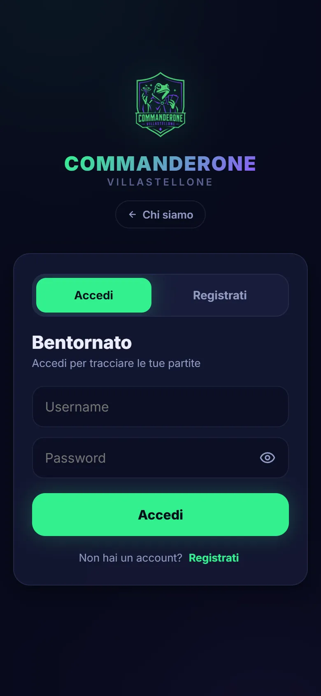

*La pagina di accesso. Da qui c’è anche il link alla presentazione del gruppo.*

### Accedere

1. Apri il sito e inserisci **nome utente** e **password**.
2. Premi **Accedi**: entri nel Feed, la home del portale.
3. L’accesso resta attivo sul dispositivo. Quando la sessione scade l’app te lo dice e ti riporta qui.

### Registrarsi la prima volta

Premi **Registrati**, scegli nome utente e password e inserisci il **codice d’invito**. Il codice lo dà un membro del gruppo o un amministratore: senza non si crea l’account.

> 💡 Hai dimenticato la password? Chiedi a un amministratore di reimpostarla dal pannello Admin.

### Installare l’app sul telefono

Commanderone è una web app installabile: si apre a schermo intero come un’app vera, senza passare dallo store.

| Telefono | Come fare |
|---|---|
| iPhone (Safari) | Tasto **Condividi** → **Aggiungi alla schermata Home** |
| Android (Chrome) | Menu **⋮** → **Installa app** (o **Aggiungi a schermata Home**) |

> 💡 Chi non è ancora del gruppo può conoscerci dalla pagina pubblica **/info**: chi siamo, come giochiamo, quando e dove. Da lì il pulsante **Entra nel pod** porta al login.

---

## 2. Muoversi nell’app

**In alto il logo, la campanella e il tuo avatar. In basso la barra con le cinque sezioni.**

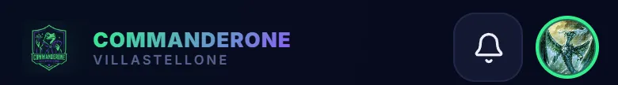

*Barra in alto: logo, notifiche e avatar.*

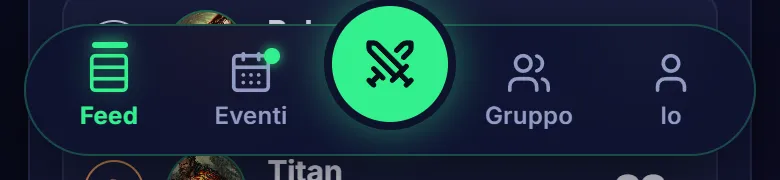

*La barra in basso. Il pulsante tondo al centro è Gioca.*

| Pulsante | Cosa trovi |
|---|---|
| **Feed** | La home: la tua stagione, la prossima serata e le ultime partite |
| **Eventi** | Il calendario. Il pallino verde segnala un evento in arrivo |
| **Gioca** (centro) | Registra partita, tavoli aperti, Giudice |
| **Gruppo** | Classifica, giocatori, mazzi e storico di tutti |
| **Io** | Il tuo profilo |

### Il menu dell’avatar

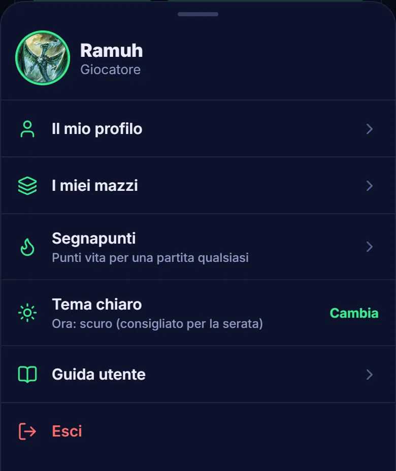

*Tocca il tuo avatar in alto a destra.*

- **Il mio profilo** e **I miei mazzi**.
- **Segnapunti**: punti vita per una partita qualsiasi, anche fuori dai tavoli (vedi il capitolo dedicato).
- **Tema chiaro / scuro**: lo scuro è pensato per la serata al tavolo. La scelta resta sul dispositivo.
- **Guida utente**: questa pagina.
- **Pannello Admin** (solo amministratori) ed **Esci**.

> 💡 Da computer le stesse sezioni sono nella barra in alto: Feed, Gioca, Eventi, Gruppo, Mazzi.

---

## 3. Feed, la home

**Tutto quello che ti serve sapere appena apri l’app, in una colonna.**

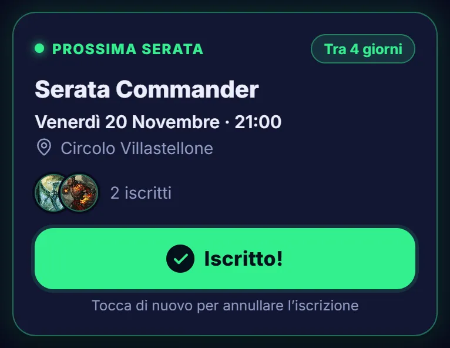

*La prossima serata, con il pulsante per iscriverti.*

**Prossima serata**: titolo, giorno, ora, luogo e chi è già iscritto. Tocca **Ci sei?** per segnarti: diventa **Iscritto!**. Ritoccalo per toglierti.

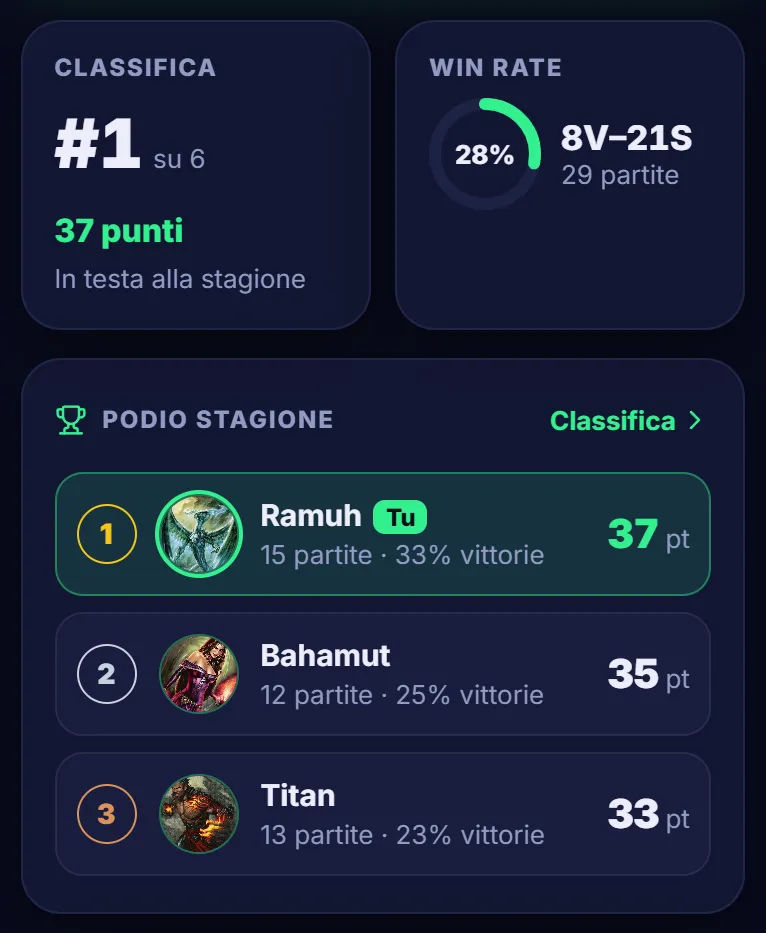

*La tua posizione nella stagione e il podio.*

- **Classifica**: la tua posizione nella stagione in corso e i punti.
- **Win rate**: percentuale di vittorie, con vinte e perse.
- **Podio stagione**: i primi tre. **Classifica** apre quella completa.

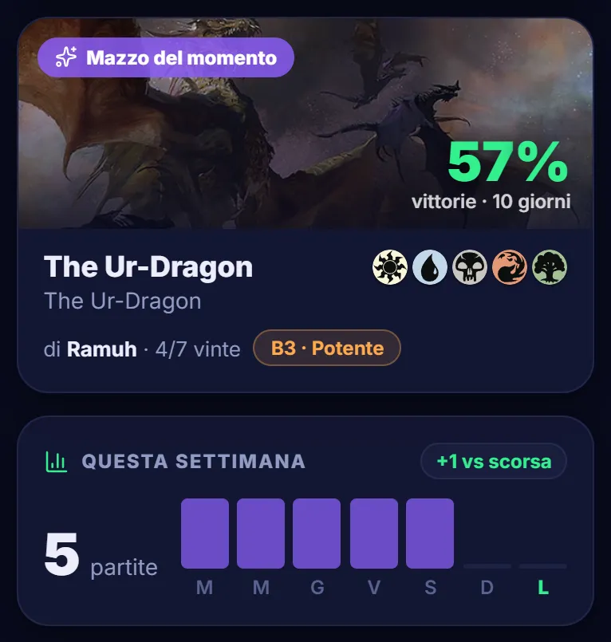

*Il mazzo più in forma e l’andamento della settimana.*

- **Mazzo del momento**: il mazzo con la miglior percentuale negli ultimi 10 giorni (almeno 3 partite).
- **Questa settimana**: partite giocate da lunedì, giorno per giorno, confrontate con la settimana scorsa.
- **Attività recente**: le ultime partite del gruppo e le tue notifiche. Tocca una partita per aprirla.

---

## 4. Gioca

**Il pulsante centrale della barra. È il punto di partenza della serata.**

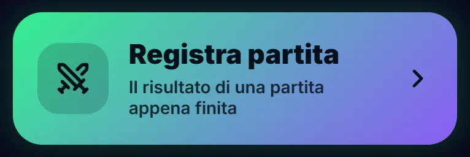

*Il pulsante grande porta dritto a Registra partita.*

- **Registra partita**: il risultato di una partita appena finita.
- **Tavoli aperti adesso**: siediti a un tavolo o aprine uno tu (capitolo successivo).
- **Stasera**: se sei in un tavolo di torneo compare qui, con il pulsante per registrarne il risultato.
- **Chiedi al Giudice**: dubbi sulle regole.
- **Ultimi mazzi usati**, **Prossimo evento** e **La tua ultima partita**, a un tocco.

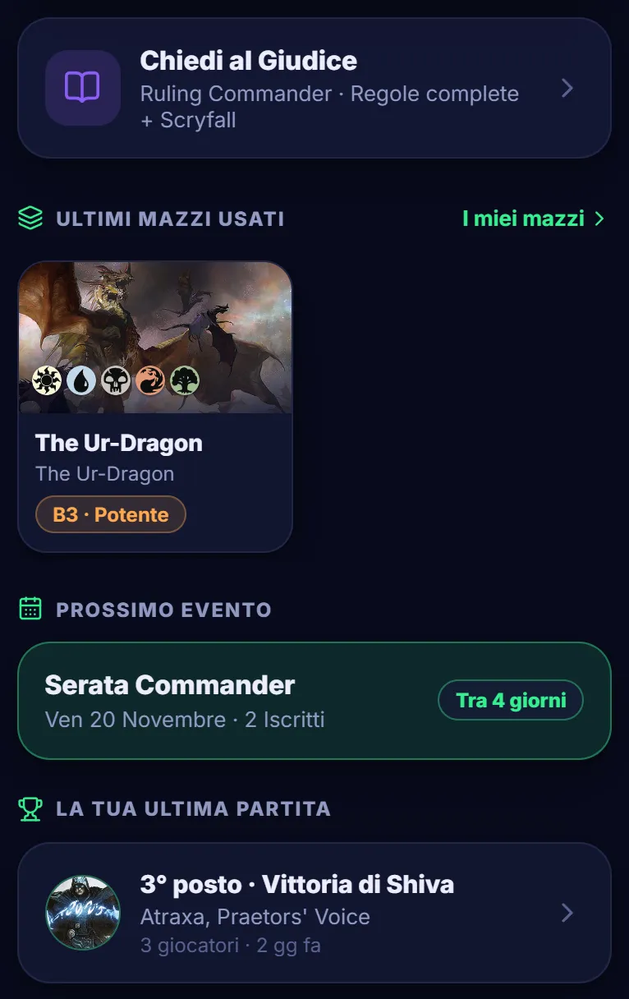

*Più in basso: Giudice, mazzi recenti, prossimo evento e ultima partita.*

---

## 5. Tavoli aperti

**Formare un tavolo con un tocco: tu lo apri, gli altri vedono i posti liberi e si siedono.**

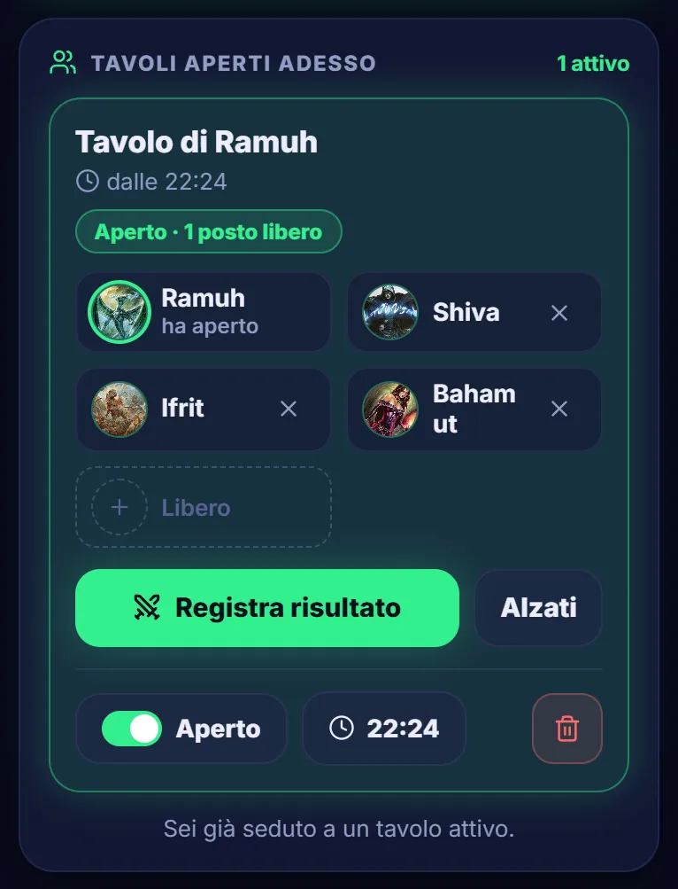

*Un tavolo aperto da Ramuh con quattro giocatori e un posto libero.*

### Aprire un tavolo

1. In **Gioca** (o nella pagina della serata) premi **Apri un tavolo**. Sei già seduto, l’orario è adesso.
2. Gli altri vedono il tavolo e premono **Siediti**. Ti arriva una notifica per ognuno.
3. Quando siete al completo usa l’interruttore **Aperto** per chiuderlo: nessun altro potrà entrare.
4. Premi **Apri il tavolo** per la pagina del tavolo: mazzi e segnapunti.

- Al massimo **5 posti**, chi apre compreso.
- Puoi cambiare l’**orario**, togliere qualcuno con la **×** o **cancellare** il tavolo (cestino).
- **Alzati** ti toglie dal tavolo. Se si alza chi l’ha aperto, il tavolo passa al primo seduto.
- Se c’è una serata in calendario il tavolo si aggancia da solo a quella serata. Nei tornei 1v1 non si aprono tavoli.

### La pagina del tavolo

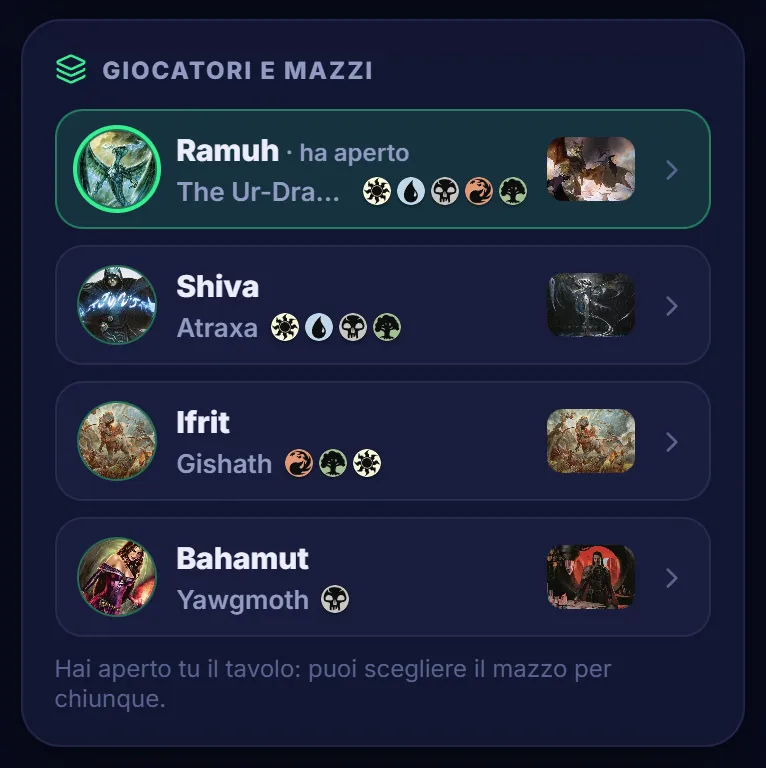

*Ognuno sceglie il mazzo che sta giocando.*

La vedono solo i giocatori seduti. Tocca la tua riga per scegliere il mazzo. Chi ha aperto il tavolo può sceglierlo per tutti.

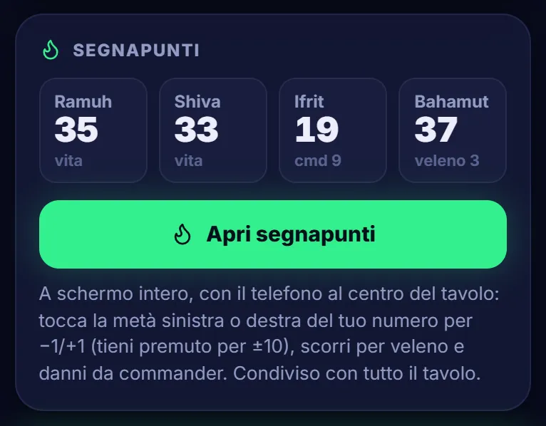

*Il riassunto dei punti, aggiornato per tutto il tavolo.*

A fine partita premi **Registra risultati** (servono almeno 3 giocatori): si apre Registra partita con giocatori e mazzi già inseriti. Salvata la partita, il tavolo risulta **Concluso** e il segnapunti si azzera.

---

## 6. Il segnapunti

**Il telefono al centro del tavolo, un riquadro per giocatore girato verso di lui. Condiviso con tutto il tavolo.**

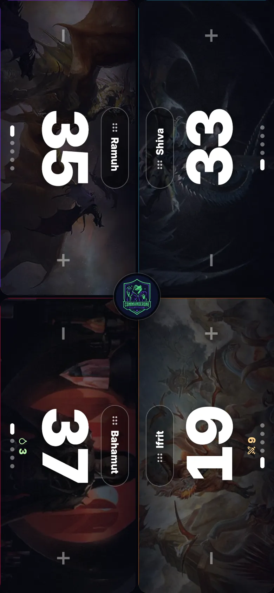

1. Tocca la **metà “meno”** del riquadro: −1. Tieni premuto: −10, ripetuto.
2. Tocca la **metà “più”**: +1. Tieni premuto: +10, ripetuto.
3. **Scorri** lungo il riquadro per cambiare contatore: vita → veleno → danni da commander di ciascun avversario. I puntini dicono dove sei. Dopo 5 secondi torna alla vita.
4. **Tieni premuto il nome** e trascinalo su un altro posto: i due giocatori si scambiano di posto.
5. Tocca lo **stemma** al centro per il menu.
6. Veleno e danni da commander restano visibili in piccolo sotto la vita.

Si apre dalla pagina del tavolo con **Apri segnapunti**. Ogni modifica arriva sui telefoni di tutti i seduti in pochi secondi. Chiuderlo non azzera niente.

| Contatore | Parte da | Fuori quando |
|---|---|---|
| Vita | 40 | arriva a 0 |
| Veleno | 0 | arriva a 10 |
| Danni da commander | 0 per avversario | 21 dallo stesso commander (tolgono anche vita) |

### Il menu dello stemma

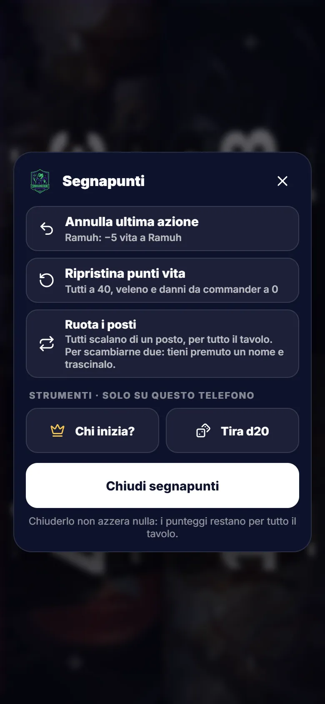

*Il menu che si apre toccando lo stemma.*

- **Annulla ultima azione**: mostra cosa annulla prima di farlo.
- **Ripristina punti vita**: tutti a 40, veleno e danni a 0. Solo chi ha aperto il tavolo.
- **Ruota i posti**: tutti scalano di un posto, per tutto il tavolo.
- **Chi inizia?** e **Tira d20**: valgono solo sul tuo telefono.
- **Chiudi segnapunti**: torni alla pagina del tavolo, i punti restano.

---

## 7. Segnapunti libero

**Per una partita qualsiasi, anche senza tavolo e con amici che non hanno l’account.**

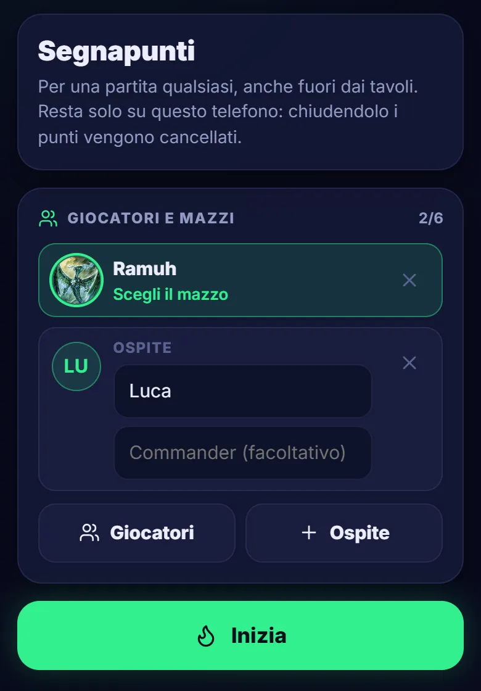

*Un giocatore registrato e un ospite.*

1. Tocca il tuo avatar → **Segnapunti**. Ci sei già tu.
2. Aggiungi giocatori del gruppo con **Giocatori** (col loro mazzo) o amici con **Ospite** (nome e, se vuoi, commander).
3. Da 2 a 6 giocatori, poi **Inizia**. I gesti sono gli stessi del segnapunti del tavolo.

- Resta **solo su questo telefono**. Se ricarichi la pagina i punti ci sono ancora.
- **Chiudi segnapunti** chiede conferma e cancella i punti.
- Se siete almeno 3 e tutti registrati, nel menu c’è **Registra risultati**: apre Registra partita già compilata.

---

## 8. Registrare una partita

**Quattro passi, due obbligatori. Più dettagli inserisci, più ricche sono le statistiche.**

### 1. Chi ha giocato

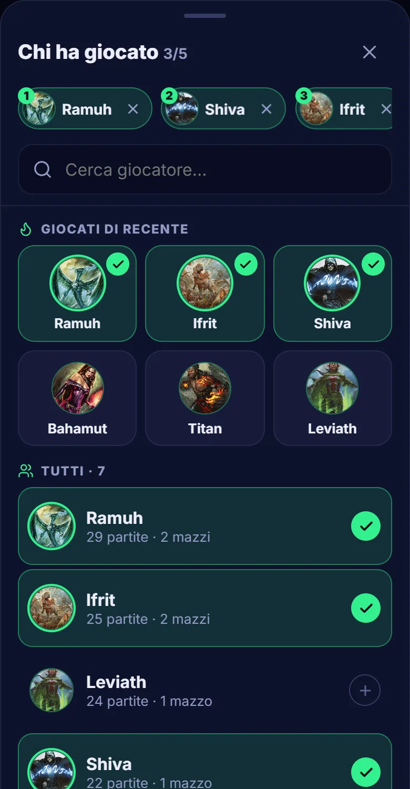

*Cerca per nome o tocca chi ha giocato di recente.*

Premi **Scegli i giocatori** e tocca da 3 a 5 persone. In alto trovi chi ha giocato di recente. Poi scegli il **mazzo** di ognuno: chi ne ha uno solo lo trova già inserito.

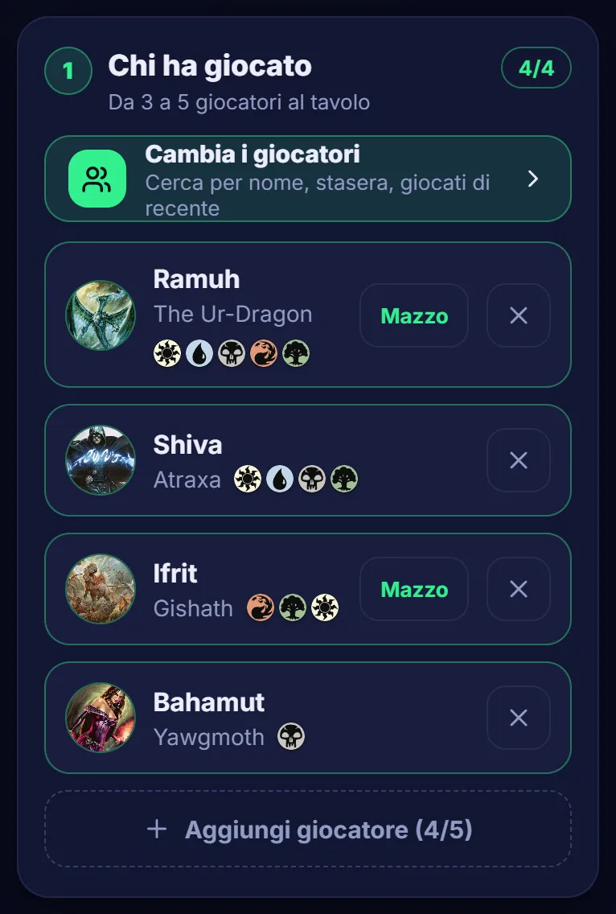

*Ogni giocatore con il suo mazzo.*

### 2. Chi ha vinto

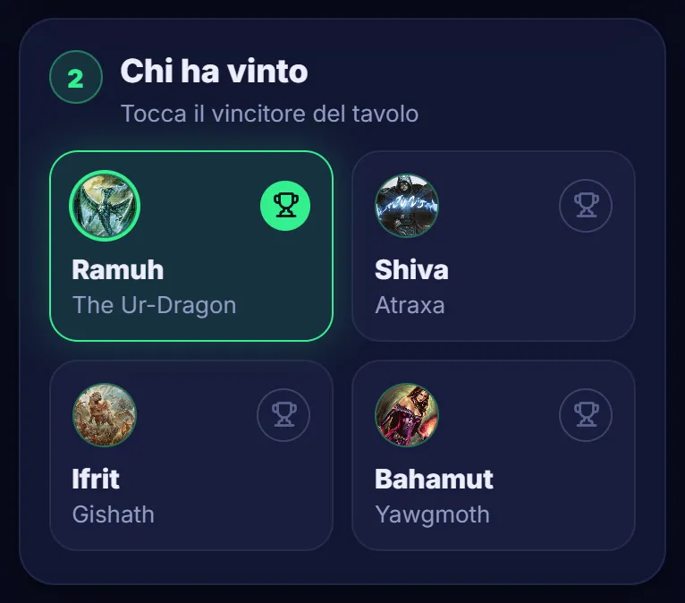

*Tocca il vincitore.*

### 3. Ordine di eliminazione (facoltativo)

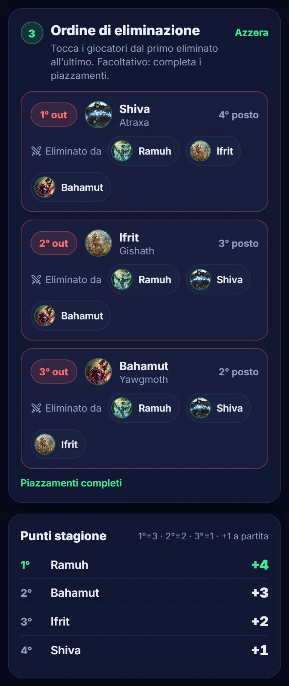

*Chi è uscito per primo, chi l’ha eliminato e i punti che ne derivano.*

Tocca i giocatori **dal primo eliminato all’ultimo**: i piazzamenti si calcolano da soli. Sotto ognuno indica **chi l’ha eliminato**: serve per arcinemico, kill e primati.

> 💡 Senza ordine di eliminazione contano solo vittoria (+3) e presenza (+1). Con l’ordine completo prendono punti anche 2° e 3°.

### 4. Data e note

La data è oggi: toccala in alto per una partita passata. Nelle **Note** un ricordo della partita. Poi **Salva**, e partono i coriandoli.

> 💡 Se arrivi da un tavolo aperto, da un tavolo di torneo o dal segnapunti libero, giocatori e mazzi sono già inseriti.

---

## 9. Partite, commenti e reazioni

**Ogni partita ha la sua pagina, con piazzamenti, eliminazioni e la parte social.**

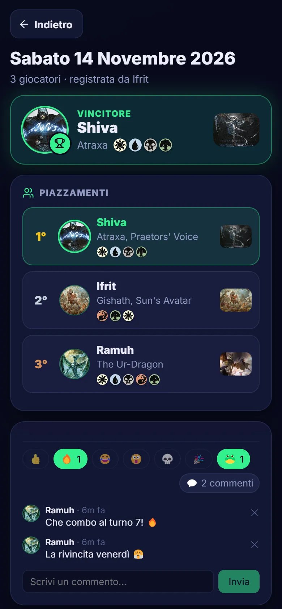

*Vincitore, piazzamenti, reazioni e commenti.*

- La apri toccando una partita nel Feed, nello Storico o in un profilo.
- **Reazioni**: 👍 🔥 😂 😮 💀 🎉 🐸. Tocca per reagire, ritocca per togliere.
- **Commenti**: scrivi e premi **Invia**. I tuoi li elimini con la ×.
- Gli altri giocatori della partita ricevono una notifica.

> 💡 Hai sbagliato a registrare? Un amministratore può correggere o eliminare la partita dal pannello Admin.

---

## 10. I tuoi mazzi

**Crea i mazzi una volta, poi li scegli in un tocco a ogni partita.**

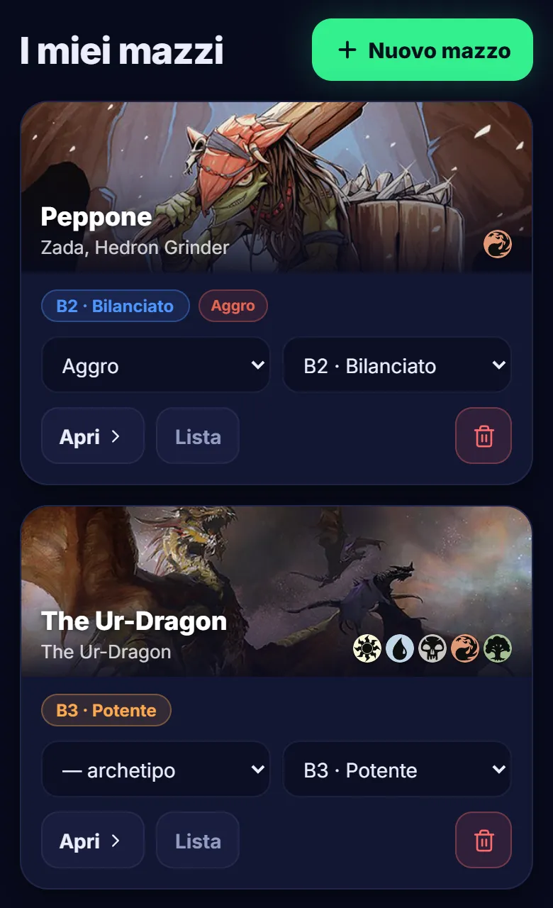

*Ogni mazzo con l’illustrazione del commander, livello e archetipo.*

### Creare un mazzo

1. Avatar → **I miei mazzi** → **Nuovo mazzo** (o **+ Aggiungi** dal tuo profilo).
2. Dai un **nome** e scrivi il **commander**: scegli dai suggerimenti, così l’illustrazione è giusta.
3. I **colori** si riconoscono dal commander.
4. Scegli **livello** e **archetipo**, se vuoi, e salva.

### Livello e archetipo

Si cambiano dai due menu sulla card e si salvano subito.

| Livello | In breve |
|---|---|
| **B1 · Casual** | Divertimento, niente combo veloci |
| **B2 · Bilanciato** | Mazzo onesto, sinergie ma non spietato |
| **B3 · Potente** | Ottimizzato, combo e tutor |
| **B4 · cEDH** | Massima potenza competitiva |

Archetipi: **Aggro, Midrange, Control, Combo, Stax, Aristocrats, Tokens, Voltron, Ramp**.

### La lista delle carte

Premi **Lista** sulla card. Puoi **importarla da un link** (Archidekt funziona sempre; Moxfield spesso blocca: lì usa Export → Text e incolla) oppure scriverla a mano, una carta per riga: `1 Sol Ring`. Con **Modifica mazzo** cambi anche nome e commander.

> 💡 Al salvataggio l’app controlla che le carte siano **100** (commander compreso) e che ogni nome esista. Se qualcosa non torna ti dice quale carta correggere.

### Il profilo del mazzo

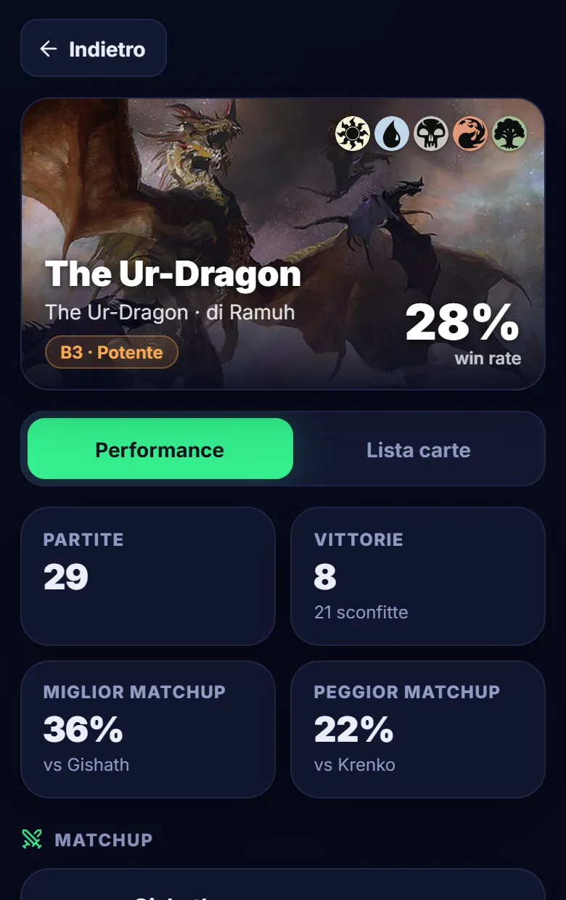

*Performance: partite, win rate, matchup, prezzo stimato.*

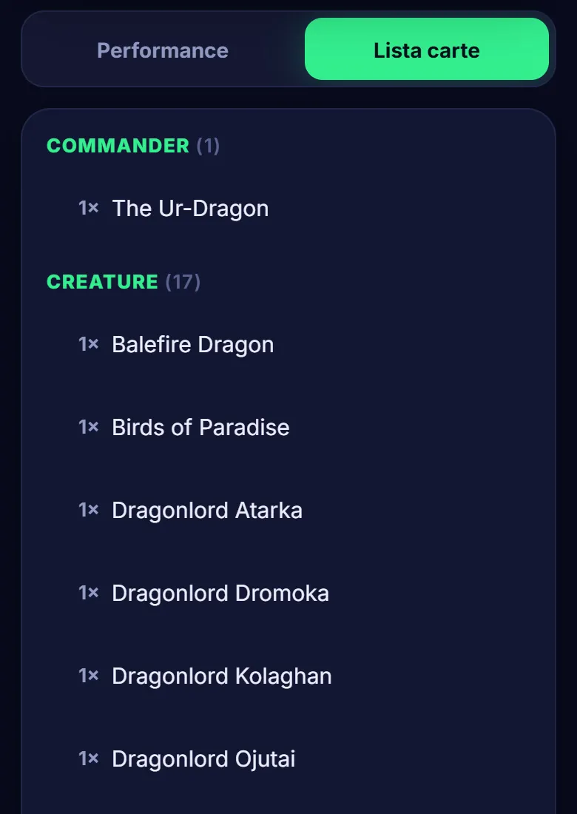

*Lista carte divisa per tipo. Tocca una carta per vederla.*

Nella scheda **Performance** trovi anche la stima del prezzo in euro (prezzi Scryfall) e l’andamento del win rate. Un mazzo si elimina solo se non ha partite registrate.

---

## 11. Gruppo e stagioni

**Le statistiche di tutti: classifica della stagione, giocatori, mazzi e storico delle partite.**

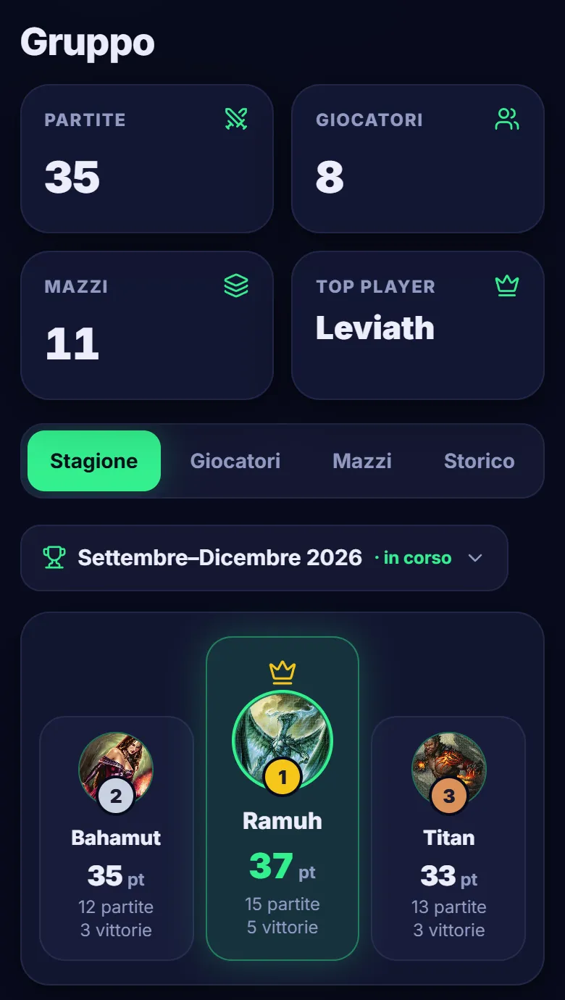

*In alto i numeri del gruppo, sotto le quattro schede.*

### Come funziona la stagione

Ci sono tre stagioni l’anno: **gennaio–aprile**, **maggio–agosto**, **settembre–dicembre**. Ripartono da sole.

| Piazzamento | Punti |
|---|---|
| 1° (vittoria) | 3 |
| 2° | 2 |
| 3° | 1 |
| Ogni partita giocata | +1 |

Per vincere la stagione bisogna essere **qualificati**: aver giocato almeno il **30%** delle partite della stagione. Col menu della stagione sfogli quelle passate.

> 💡 Per le stagioni concluse c’è il pulsante **Infografica**: un riepilogo in tre slide da scaricare e pubblicare su Instagram.

### Primati e meta

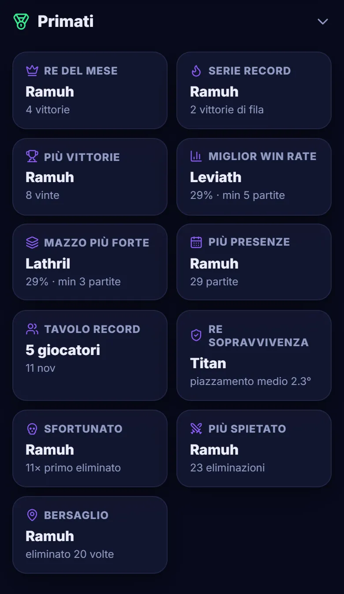

*I record del gruppo.*

**Primati**: re del mese, serie record, più vittorie, miglior win rate, mazzo più forte, più presenze, tavolo record, re della sopravvivenza, sfortunato, più spietato, bersaglio. **Meta colori**: win rate per colore e partite mese per mese.

### Le altre schede

- **Giocatori**: tutti, in ordine di win rate. Tocca per aprire il profilo.
- **Mazzi**: tutti i mazzi del gruppo, con livello e archetipo.
- **Storico**: tutte le partite, filtrabili per periodo o per date, con reazioni e commenti.

---

## 12. Il tuo profilo

**Avatar, stagione, achievement, mazzi e tutte le tue statistiche. Lo apri con Io nella barra.**

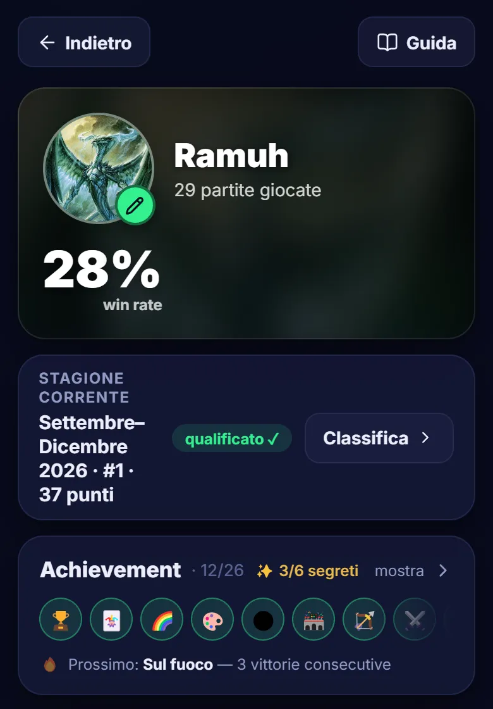

*Il tuo profilo: avatar, win rate, stagione e achievement.*

### L’avatar

Finché non ne scegli uno, l’avatar è l’illustrazione del **commander che giochi di più**. Per sceglierlo tocca la **matita** sull’avatar, cerca una carta e scegli la stampa che preferisci.

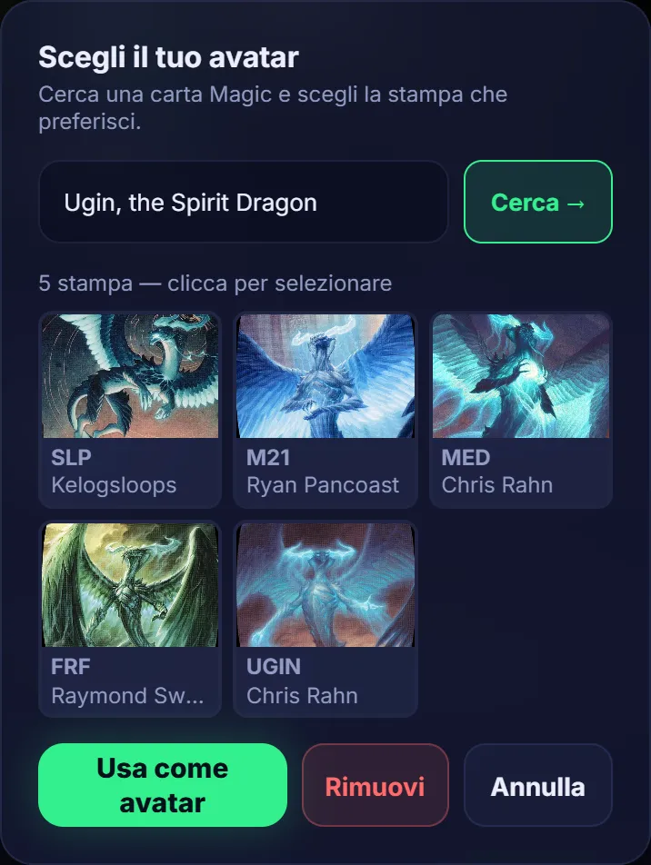

*Ogni stampa ha la sua illustrazione.*

Premi **Usa come avatar**. **Rimuovi** torna all’avatar automatico. L’avatar compare ovunque: classifiche, tavoli, commenti, iscritti agli eventi.

### Achievement

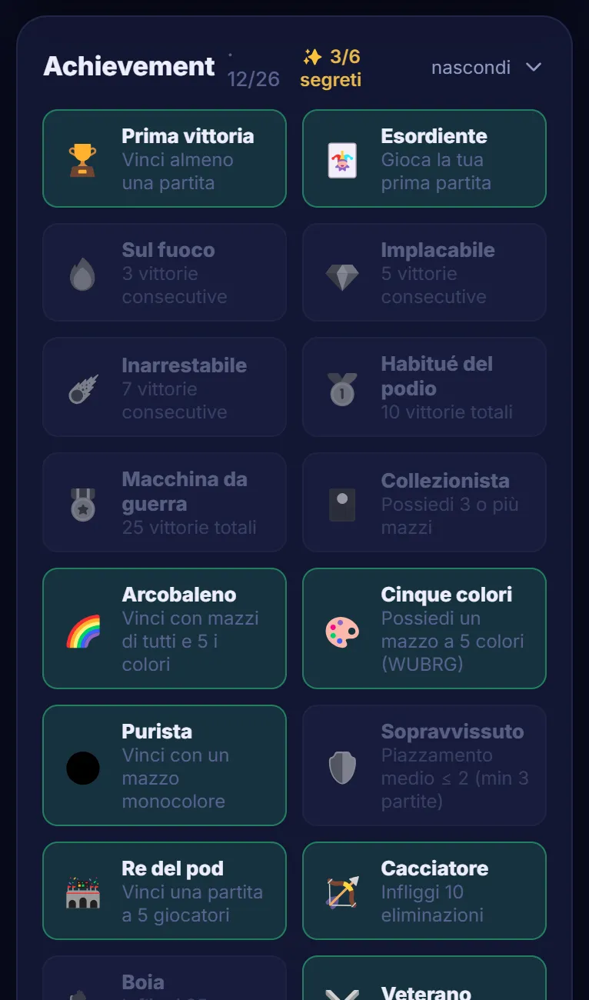

*Quelli sbloccati sono evidenziati.*

- **26 achievement**: 20 visibili da subito, 6 **segreti** che compaiono solo quando li sblocchi.
- Quando la sezione è chiusa vedi il **prossimo** da sbloccare.
- Due si assegnano solo a **stagione conclusa**: campione e stagione perfetta.
- Ogni sblocco ti arriva come notifica.

### Le altre sezioni

- **Stagione corrente**: posizione, punti e se sei qualificato.
- **I miei mazzi**: con livello, archetipo, lista ed eliminazione.
- **Scontri diretti**: scegli un avversario e guarda il testa a testa.
- **Statistiche dettagliate**: eliminazioni fatte e subite, arcinemico, preda preferita, piazzamento medio, andamento.
- **Storico partite**.

---

## 13. Eventi e tornei

**Il calendario del gruppo: serate, tornei multiplayer e tornei 1v1.**

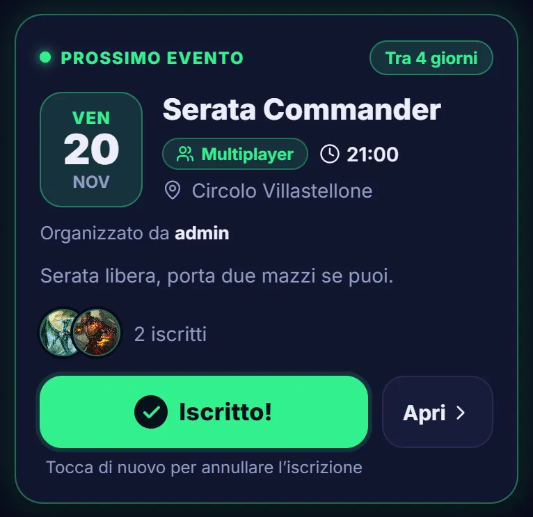

*Data, formato, luogo, chi organizza e chi viene.*

- Due schede: **Prossimi** e **Passati**. Un evento passa tra i passati alle 5 del mattino dopo.
- **Ci sei?** ti iscrive, **Iscritto!** conferma. Ritoccalo per toglierti.
- **Apri** porta alla pagina dell’evento.

| Formato | Come si gioca |
|---|---|
| **Solo evento** | Serata libera: le partite registrate quel giorno compaiono nella pagina dell’evento |
| **Multiplayer** | Tavoli da 3 a 5 (meglio 4) generati dall’organizzatore. Ogni tavolo è una partita vera: conta per stagione e statistiche |
| **1v1** | Svizzera al meglio di 1 o di 3, massimo 4 turni, con classifica |

### La pagina dell’evento

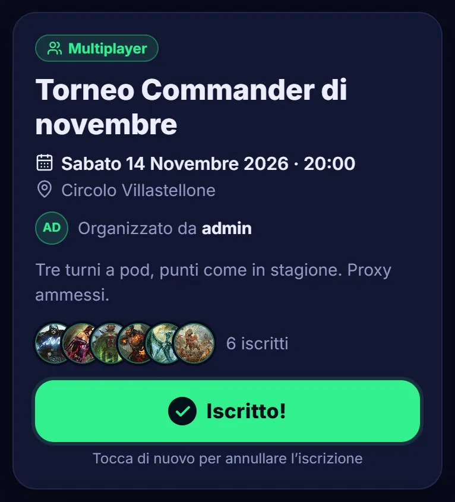

*Dettagli, organizzatore e iscritti.*

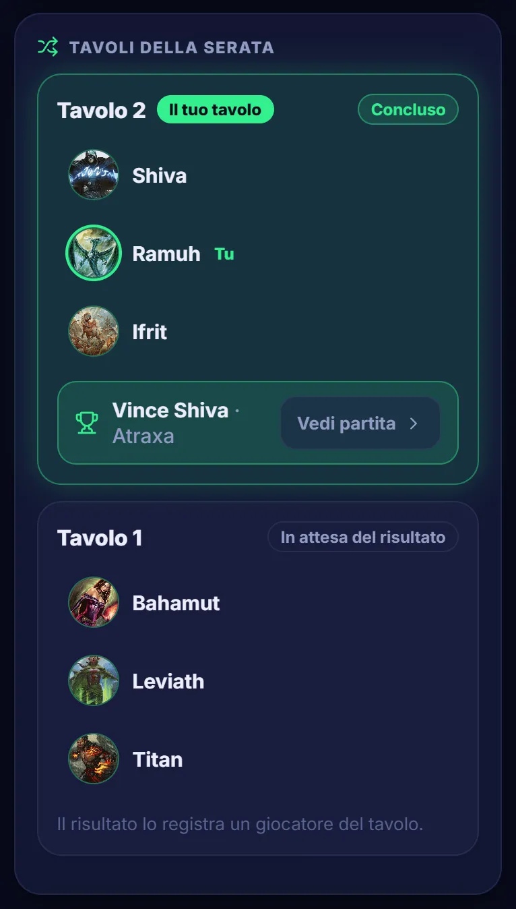

*Il tuo tavolo è evidenziato. Quando è finito mostra chi ha vinto.*

- Nei multiplayer, quando tutti sono iscritti, l’organizzatore genera i **tavoli**.
- Il risultato lo registra un giocatore del tavolo con **Registra partita del tavolo**: giocatori già inseriti.
- Più in basso: **Tavoli aperti della serata** e **Partite della serata**.
- Nei 1v1 si registra il punteggio del match (o il pareggio) e la classifica si aggiorna da sola.

> 💡 Servono mazzi per entrare in un tavolo di torneo: crea almeno un mazzo prima della serata.

---

## 14. Il Giudice

**Dubbi su una regola? Chiedi in italiano, anche informale.**

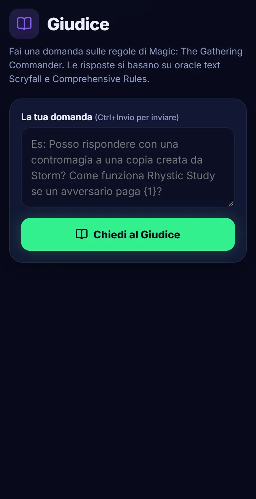

*Domanda in alto, sotto lo storico del gruppo.*

1. Da **Gioca** → **Chiedi al Giudice**.
2. Scrivi la domanda, anche con nomi di carte e abbreviazioni.
3. Premi **Chiedi al Judge** (da tastiera Ctrl+Invio).

Ricevi la risposta con un indicatore di **affidabilità**, la spiegazione, le **carte riconosciute** e le **regole ufficiali** citate. Sotto trovi le ultime 20 domande del gruppo: magari qualcuno l’ha già chiesto.

> ⚠️ Il Giudice usa l’intelligenza artificiale e può sbagliare. Per le partite che contano verifica sulle regole ufficiali.

---

## 15. Notifiche

**La campanella in alto ti dice cosa è successo mentre non c’eri.**

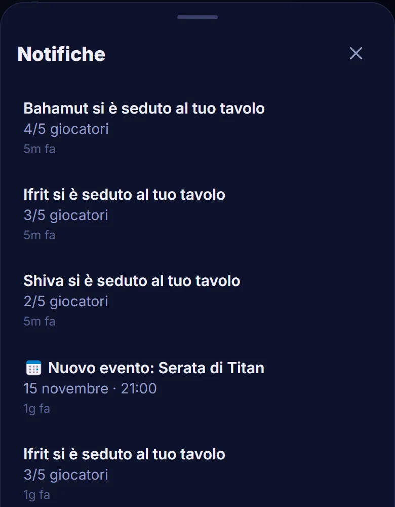

*Tocca una notifica per andare al punto giusto.*

- Un nuovo **evento** in calendario.
- Qualcuno si **siede al tuo tavolo**.
- Un **achievement** sbloccato.
- Un **commento** o una **reazione** a una tua partita.

Il numero sulla campanella sono le non lette: aprendo l’elenco diventano lette. Si aggiorna da sola ogni minuto.

---

## 16. Organizzatori e amministratori

**Chi crea gli eventi e chi gestisce il portale.**

### Organizzatore

Un giocatore a cui l’amministratore dà il permesso di **creare eventi**. Gioca e compare in classifica come tutti. Degli eventi che crea può fare tutto: modificarli, eliminarli, generare turni e tavoli, registrare i risultati. Gli altri lo vedono come “Organizzato da”.

1. In **Eventi** premi **Nuovo evento**.
2. Titolo, data, ora (facoltativa), luogo, descrizione.
3. Formato: **Solo evento**, **Multiplayer** o **1v1** (al meglio di 1 o di 3).
4. Premi **Crea evento**: tutti gli altri ricevono una notifica.

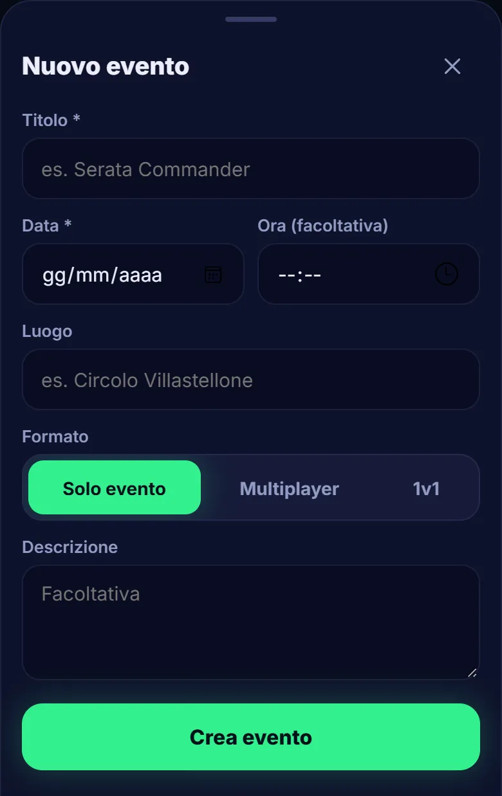

*Il modulo per creare un evento.*

### Amministratore

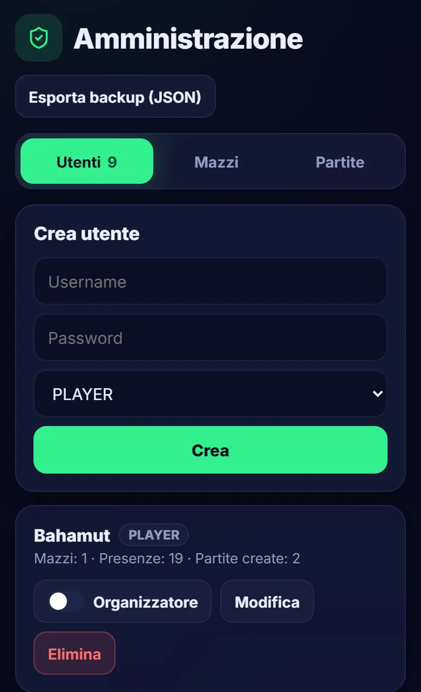

*Il pannello Admin, scheda Utenti, con l’interruttore Organizzatore.*

- **Utenti**: crea account, cambia nome e password, rende un giocatore **Organizzatore** con l’interruttore.
- **Mazzi**: gestisce i mazzi di tutti.
- **Partite**: corregge o elimina qualsiasi partita.
- **Esporta backup**: scarica tutti i dati in un file.
- Gestisce tutti gli eventi, anche quelli creati da altri.

> 💡 L’account admin non gioca: non compare in classifiche e statistiche.

---

## Domande frequenti

**Ho dimenticato la password.**  
Chiedi a un amministratore: la reimposta dal pannello Admin.

**Il mio mazzo non mostra l’illustrazione del commander.**  
Il nome non combacia con quello ufficiale. Apri la lista del mazzo, premi Modifica mazzo e riscrivi il commander scegliendolo dai suggerimenti.

**Devo per forza inserire l’ordine di eliminazione?**  
No. Ma senza contano solo vittoria e presenza, e mancano kill, arcinemico e piazzamenti.

**Come si vince la stagione?**  
Con più punti tra i qualificati: 3 al primo, 2 al secondo, 1 al terzo, più 1 a ogni partita giocata. Qualificato è chi gioca almeno il 30% delle partite della stagione.

**Il segnapunti del tavolo lo vedono tutti?**  
Sì, tutti i giocatori seduti, anche su telefoni diversi. Il segnapunti libero dal menu dell’avatar invece resta solo sul tuo telefono.

**Ho chiuso per sbaglio il segnapunti del tavolo.**  
Nessun problema: i punti restano. Riaprilo dalla pagina del tavolo con Apri segnapunti.

**Perché non riesco a entrare in un tavolo?**  
Il tavolo è chiuso o al completo (5 posti), oppure sei già seduto a un altro tavolo attivo.

**Posso creare un evento?**  
Solo se sei organizzatore o amministratore. Gli altri si iscrivono con Ci sei?.

**Non trovo un achievement che avevo.**  
Gli achievement sbloccati restano tuoi anche se poi le statistiche cambiano. Quelli segreti compaiono solo dopo lo sblocco.

**Si può usare da computer?**  
Sì: stesse funzioni, con la barra di navigazione in alto.

---

*Buone partite, e che vinca il mazzo migliore. 🐸*

<!-- File generato da frontend/scripts/build-guide-md.mjs: modifica frontend/src/pages/guida/guideContent.js e rilancia `npm run guide:md`. -->
